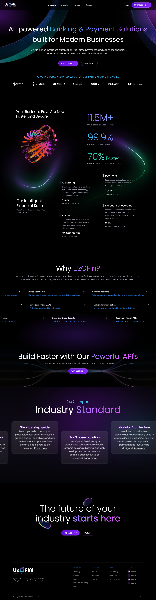
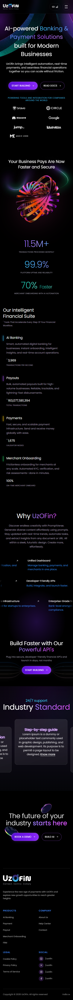

# UzOFin – AI-powered Banking & Payments Landing Page

Pixel-focused implementation of the UzOFin design (`docs/design-reference.png`) built with
**React 18 (functional components + hooks), Vite, SCSS (7-1 + BEM) and GSAP**, using the original design artwork.

| Desktop | Mobile |
| --- | --- |
|  |  |

---

## Quick start

```bash
npm install
npm run dev       # http://localhost:5173  (opens automatically)
npm run build     # production build → dist/
npm run preview   # serve the production build (http://localhost:4173)
npm run lint      # ESLint (flat config, react-hooks rules)
```

Requires Node 18+.

---

## Tech stack

| Concern | Choice | Why |
| --- | --- | --- |
| UI | React 18, functional components, custom hooks | Requirement + component reuse |
| Build | Vite 5 | Fast dev server, code splitting, small output |
| Styles | SCSS (modern compiler) · 7-1 pattern · BEM | Scalable architecture, no inline CSS |
| Animation | GSAP 3 + ScrollTrigger | Scroll reveals, counters, marquees, intro timeline |
| Artwork | Design images in `src/assets/images` | Hero ring, ribbon sphere poster, glow curves, API wires, glass coins, logos |
| Audio | Web Audio API (synthesised) | Click/hover/load sounds, no audio files |
| Cross-browser | Autoprefixer + `browserslist` | `-webkit-mask`, `backdrop-filter`, `background-clip` for Safari |

---

## Folder structure

```
src/
├── App.jsx                  # Page composition + preloader hand-off
├── main.jsx                 # React entry
├── assets/images/           # design artwork, renamed by section (see index.js)
├── data/siteContent.js      # ALL copy & data (components stay presentational)
├── context/SoundContext.jsx # Sound provider + useSound()
├── hooks/                   # Reusable logic
│   ├── useReveal.js         #   scroll reveal for [data-reveal] (ScrollTrigger.batch)
│   ├── useCountUp.js        #   animated counters
│   ├── useMarquee.js        #   infinite GSAP marquee (slows on hover)
│   ├── useScrolled.js       #   header state on scroll (rAF throttled)
│   └── useScrollLock.js     #   lock body scroll (preloader / mobile menu)
├── utils/
│   ├── gsap.js              # plugin registration (single source)
│   ├── bem.js               # bem(styles, block) helper for CSS Modules
│   ├── audio.js             # Web-Audio synth engine
│   └── helpers.js           # cx(), formatNumber(), prefersReducedMotion()
├── components/              # every component = its own folder
│   ├── common/
│   │   ├── Button/
│   │   │   ├── Button.jsx
│   │   │   ├── Button.module.scss   ← scoped styles for this component only
│   │   │   └── index.js
│   │   ├── Counter/  GradientText/  Icon/  Logo/  MarqueeRow/
│   │   ├── Preloader/  SectionHeading/  SoundToggle/
│   │   └── index.js         # barrel: import { Button, Logo } from '@/components/common'
│   ├── layout/              # Header/, Footer/
│   ├── cards/               # StatItem/, SuiteCard/, FeatureLink/, IndustryCard/
│   ├── visuals/             # HeroArcs/, GlowCurve/, WireLines/, GlassShape/,
│   │                        # RibbonSphere/ (design image, GSAP step rotation like the prototype)
│   └── sections/            # Hero/, Partners/, Stats/, Suite/, WhyUs/,
│                            # ApiSection/, Industry/, Cta/
└── styles/                  # GLOBAL only (7-1 pattern)
    ├── abstracts/           # variables, functions (rem, fluid, z), mixins (mq, glass…)
    ├── vendors/
    ├── themes/              # CSS custom properties (dark theme)
    ├── base/                # reset, base, typography, skip-link
    ├── layout/              # .container, .section utilities
    └── main.scss
```

### Styling approach: CSS Modules + BEM

Each component imports its own `Component.module.scss`. Class names are scoped
automatically (e.g. `btn__label_x7Kq2`), so styles can never leak between components.
BEM naming is kept inside every module, and `utils/bem.js` keeps the JSX readable:

```jsx
import styles from './Button.module.scss';
const b = bem(styles, 'btn');

<a className={b(null, ['primary', 'sm'])}>        // .btn .btn--primary .btn--sm
  <span className={b('label')}>Start</span>       // .btn__label
</a>
```

Every module starts with `@use 'abstracts' as *;`, which `loadPaths` in `vite.config.js`
resolves to `src/styles/abstracts`, so all tokens and mixins are available everywhere.
GSAP targets `data-*` attributes (e.g. `data-anim="line"`), never the hashed class names.

---

## Sections

1. **Preloader**: logo, 0→100 counter and progress bar, then the curtain slides up and hands off to the hero intro
2. **Header**: glass effect on scroll, hover/focus dropdowns, full-screen mobile menu with accordion, sound toggle
3. **Hero**: masked line-by-line title reveal; neon conic-gradient rings that rotate slowly and parallax on scroll
4. **Partners**: logo strip
5. **Stats**: ribbon sphere artwork turning 90° every ~7s exactly like the Figma prototype (GSAP), count-up metrics, glow curves revealed on scroll
6. **Financial Suite**: staggered product cards, accent bars, count-up figures
7. **Why UzOFin?**: three infinite marquee rows that alternate direction and slow on hover
8. **API**: SVG "cables" bundling into the CTA, with travelling light pulses
9. **Industry Standard**: cards flow right → left in an infinite GSAP marquee and rise/fall in a wave as they travel (as in the prototype); pauses on hover, check icon slides in
10. **CTA**: floating glass shapes
11. **Footer**

---

## Requirement checklist

- [x] **React functional components & hooks** (6 custom hooks plus a context)
- [x] **SCSS: CSS Modules per component + 7-1 global layer + BEM**, no inline `style` attributes
- [x] **Responsive & mobile-first**: `mq()` min-width mixin, fluid `clamp()` type and spacing
- [x] **GSAP**: intro timeline, ScrollTrigger reveals, counters, infinite marquees, glow-curve reveal, floating artwork
- [x] **Design artwork**: every image from the design lives in `src/assets/images/<section>/` with readable names, registered in `src/assets/images/index.js`; all have intrinsic width/height (no layout shift)
- [x] **Hover effects / preloader / section transitions**
- [x] **Sound effects** (optional bonus): click, hover, toggle and intro chime; can be muted and the choice is saved
- [x] **Accessibility**: skip link, semantic landmarks, `aria-*` on menu, marquee regions and toggles, visible focus rings, keyboard support, `prefers-reduced-motion` respected everywhere
- [x] **Performance**: code splitting (react / gsap chunks), fingerprinted & lazy-loaded images, font `preconnect` + `display=swap`, rAF-throttled scroll handlers
- [x] **Cross-browser**: Autoprefixer with Chrome/Firefox/Edge/Safari targets, `-webkit-` fallbacks for masks, `background-clip: text` and `backdrop-filter`
